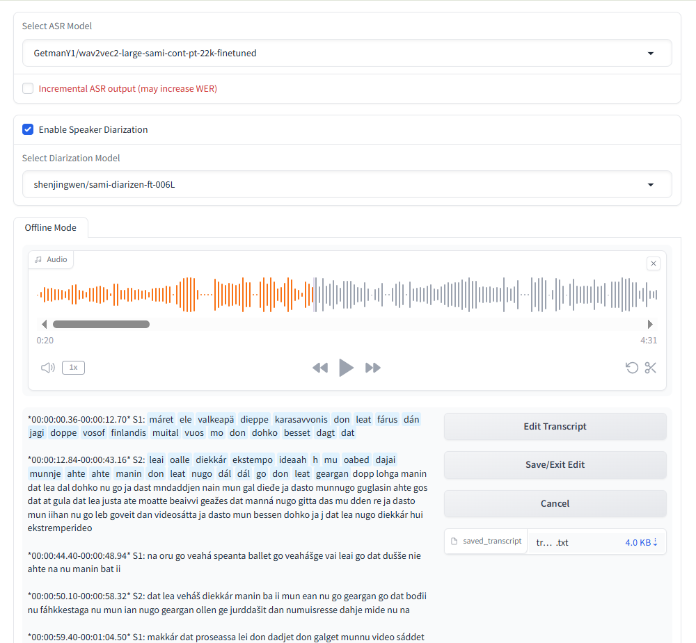

## add wen 20261012

Implemented a Northern Sami speech transcription service with speaker diarization.
Frontend built with Gradio Blocks, provides audio upload, ASR model selection,
speaker diarization, transcript display, editing, and saving.

## Service Link 
http://xxx.xxx.xxx.xxx:7860/
(check float ip on CSC instances)

## Key features

- Offline speaker-attributed transcription with word-level timestamp alignment and audio-text highlighting.
- Users can switch between different ASR models and diarization models at runtime.  
  Transcription and speaker attribution pipeline:  
  1. The ASR model produces the transcription. (custom_asr.py)  
  2. Forced alignment produces word-level timestamps based on ASR transcription. (utils/forced_alignment.py, utils/audio_transcript_utils.py)  
  3. The diarization model produces speaker turns — speaker + start/end timestamps. (custom_diarization.py)  
  4. Word-level timestamps and speaker turns are aligned to assign a speaker label to each word in the ASR transcription. (custom_asr.py)  
  5. The final speaker-attributed transcript is assembled as `*start-end* speaker: transcription`. (custom_diarization.py)  

  ASR and diarization are logically independent but executed sequentially in the code (ASR → forced alignment → diarization → merge), because both models need GPU memory and cannot run in parallel on a single GPU.  
  The frontend (app.py) shows ASR output first for early feedback, then replaces it with the speaker-attributed transcript once diarization finishes.

- Long audio is processed in chunks by the ASR pipeline - 100s chunks with 5s overlap. (custom_asr.py)  
  Handled by HuggingFace ASR pipeline — the pipeline merges chunk results with proper stride handling and returns the final transcription as a whole. Chunking happens entirely inside the pipeline for long-audio ASR processing. It does not change how results are returned; the pipeline does not output chunk by chunk.
	

- Optional incremental ASR output mode, with a WER trade-off warning. (app.py)  
  This only affects how ASR results are segmented and streamed to the frontend.  
  The HuggingFace ASR pipeline does not natively support chunk-by-chunk output, so in this mode the audio is manually split into chunks and each chunk is transcribed separately. Overlap between chunks is handled in code, which slightly increases WER.
	  
- Transcript editing: edit text, re-align with forced alignment, and save the result. (app.py)
  On save, the edited text is re-aligned with the audio via CTC forced alignment so the word-level timestamps match the new text. This takes a few seconds.  
  The `saved_transcript` file is updated automatically after saving.  

- Audio-text highlighting during playback: while the audio plays, the word being spoken is highlighted in the transcript. (utils/audio_transcript_utils.py, app.py)

### Delays
- Diarization: runs after ASR, user waits for speaker labels. (seconds to minutes, depending on audio length).
- Editing: CTC forced alignment re-runs on save. (a few seconds)
- Model switch: reloads the selected ASR or diarization model and re-generates the transcript. (seconds to minutes, depending on audio length).
  ASR model switch: reloads the ASR model and re-runs ASR on the current audio.  
  Diarization model switch: reloads the diarization model and re-runs diarization on the cached ASR result (ASR is not re-run).  

### Usage tips
- ASR-only transcription can be run first; diarization can be enabled afterwards to add speaker labels, avoiding the wait for diarization during the initial transcription.
- Alternatively, ASR and diarization can be enabled together. The frontend still shows the ASR output first for early feedback, then updates with speaker labels once diarization finishes; the user waits for speaker labels (seconds to minutes, depending on audio length).
- For long audio, both ASR and diarization take longer. "Incremental ASR output" can be enabled to stream the ASR result to the frontend chunk by chunk, but this increases WER; if not enabled, the full result must be waited for.

### Pending / WIP
- Punctuation restoration (`utils/punctuation_restorer.py`) is not integrated — the transcript currently has no punctuation.
- Double-click a word to jump the audio is WIP: The click event is captured — open F12 → Console and double-click a word, you will see `double clicked: <word>`. The audio-jump part is not yet implemented. To check backend logs: `tail -f log.txt` 
- `utils/` can be extended with more post-processing utilities.

## Working Directory
/sami_transcription_service

## Dependencies & Conda Environment
/sami_transcription_service/requirements.txt: pip-installed Python dependencies.
/sami_transcription_service/environment.yml: Update hugging face token here. `conda env create -f environment.yml`

## activate environment (command)
`conda activate sami_asr`

## start/restart the service (command)
`./start.sh --daemon`

## Logging and Debugging (command)
`tail -f log.txt`

## ASR
custom_asr.py
- https://huggingface.co/GetmanY1/wav2vec2-base-sami-cont-pt-22k-finetuned
- https://huggingface.co/GetmanY1/wav2vec2-large-sami-cont-pt-22k-finetuned
- Additional fine-tuned Sámi models under `shenjingwen/` on Hugging Face.

## Diarization
custom_diarization.py
- `shenjingwen/sami-diarizen-ft-006`
- `shenjingwen/sami-diarizen-ft-006L`
- `shenjingwen/sami-diarizen-ftl12.7h-ft-0.28b`

# References
- https://huggingface.co/shenjingwen
- https://github.com/SubtleParesh/live-speech-reference-search
- https://github.com/MahmoudAshraf97/ctc-forced-aligner/tree/main
- https://github.com/BUTSpeechFIT/DiariZen
- https://huggingface.co/GetmanY1/wav2vec2-base-sami-cont-pt-22k-finetuned
- https://huggingface.co/GetmanY1/wav2vec2-large-sami-cont-pt-22k-finetuned
